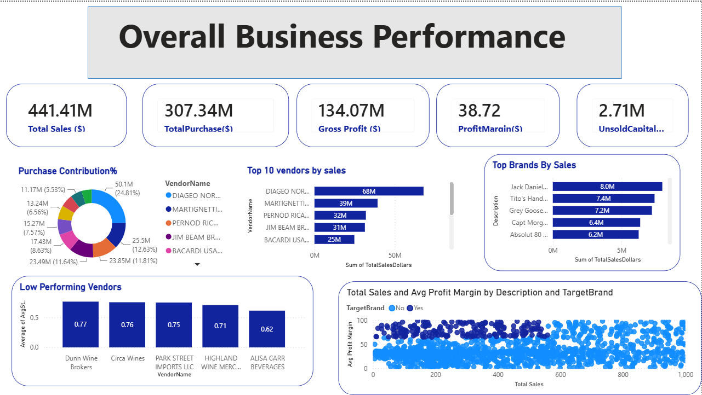
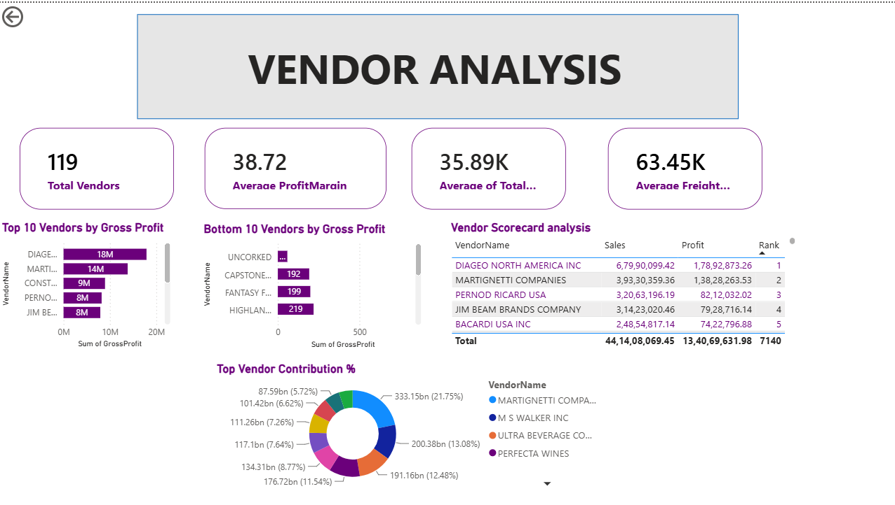

# Vendor Performance Analysis Dashboard

## Project Overview
This Power BI dashboard analyzes vendor sales, purchases, profit margins, and brand performance.

## Tools Used
- Power BI
- SQL
- Python
- Excel

## Key Metrics
- Total Sales
- Total Purchase
- Gross Profit
- Profit Margin
- Unsold Capital

## Dashboard Features

### Business Overview
- Purchase Contribution %
- Top 10 Vendors by Sales
- Top Brands by Sales
- Low Performing Vendors

### Vendor Analysis
- Top Vendors by Gross Profit
- Bottom Vendors by Gross Profit
- Vendor Scorecard
- Vendor Contribution %

## Insights
- DIAGEO NORTH AMERICA INC is the top vendor.
- MARTIGNETTI COMPANIES ranks second in sales.
- Several vendors have low profit contribution despite high purchases.

## Dashboard Screenshots

### Overview Dashboard

### Vendor Analysis

## Author
Sanjana H P